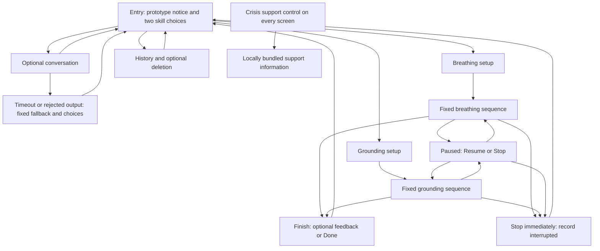

# Experience design

## Purpose and interface copy

Entry banner: **“Coursework skills prototype. Use fictional scenarios only. This is not therapy or a monitored service.”**

Primary choices: **“Breathing · about 1 minute”** and **“Grounding · about 80 seconds.”** Secondary controls: **“Optional chat,” “History,” “Simpler view,”** and **“Crisis support.”** Starting a skill never requires chat, a mood score, registration, or a profile questionnaire.

The design assumes neither BPD nor any other diagnosis. It has only user-entered text, explicit preferences, and recorded application actions. None reliably measures distress. “Simpler view” is a user choice; the application will not infer it from punctuation, sentiment, inactivity, or diagnosis language.

## Main flow



Resume returns only to the skill that was paused; it never switches skills. The final two nodes represent a globally available control, not an extra required journey. Opening crisis information during an exercise pauses it immediately. Closing the panel leaves it paused until the user chooses Resume or Stop.

## Screen sketches

```text
ENTRY                               BREATHING
[Coursework prototype notice]       [Coursework prototype] [Crisis support]
                         [Crisis support]
Choose an exercise                  Breathe in
[Breathing ~1 minute]                Count 1 / 4
[Grounding ~80 seconds]              [gentle expanding circle or static count]
                                    Cycle 2 of 6
[Optional chat] [History]            [Pause]       [Stop]
[Simpler view]

GROUNDING                           FINISH
[Prototype] [Crisis support]         [Prototype] [Crisis support]
Notice five things you can see.      Exercise finished.
You can do this silently.            Optional: Was this format useful?
Step 1 of 5                         [Yes] [No] [Skip]
[Next] [Pause] [Stop]                [Done] [Choose another exercise]
```

During exercises, hide chat, history, previous messages, and preference menus. Keep the current instruction, necessary pacing/progress, pause, stop, and crisis access. “One atomic skill” means one primary task at a time; it does not justify removing safety or exit controls. Do not queue modal confirmations before Stop. Do not display streaks, success scores, or “failed” for an interruption.

Simpler view hides optional chat and history shortcuts on entry behind a “More options” control and reduces explanatory copy. It preserves both skill choices and all safety controls. “Full view” restores the previous layout without restarting a session. Essential skill instructions never contract. Motion is subtle and optional: honor reduced-motion preferences and provide a static label/count cue with identical timing. Use visible focus, semantic buttons, readable contrast, and status announcements at phase changes rather than every second.

## Timing and preserved skill steps

Timing begins when the first exercise instruction is displayed and ends at the final planned step. Setup, optional chat, and optional feedback are outside this interval. User pauses and crisis-panel time are excluded from active duration but recorded separately. Wall-clock duration is also retained for transparency. No timer forces an exit or labels a user unsuccessful.

| Exercise | Planned timeline | Budget and assumptions |
| --- | --- | --- |
| Paced breathing | First instruction “Breathe in for four counts, then out for six”; 4 seconds to read. Six complete cycles: inhale 4 seconds, exhale 6 seconds. Final planned exhale ends the sequence. | 4 + 6 × 10 = 64 seconds; allow up to 2 seconds of accumulated rendering delay, target ≤66 seconds. No holds or model requests. Assumes one count per second, reading within 4 seconds, foreground browser. |
| Grounding | Five sequential prompts: five things seen; four felt; three heard; two smelled; one tasted. Prompt budgets of 20, 18, 16, 12, and 12 seconds include reading and silent noticing. | 78 seconds plus up to 2 seconds of transitions, target ≤80 seconds. Assumes silent identification at this pace; no typed item lists. |

Grounding provides “Next” to advance sooner. At the suggested time boundary, show “Next when ready”; do not automatically advance or discard a step. The 80-second target is therefore conditional on the intended response pace, not a hard completion guarantee. Slower unpaused responses count in measured duration and may exceed 90 seconds. This is a design uncertainty to test, not something to hide by redefining all waiting as pause. If fictional walkthroughs regularly exceed 90 seconds, revise prompt presentation or scope before claiming the assignment timing requirement is met.

Setup estimate: 10–20 seconds to read the boundary notice and choose a skill, then 5–10 seconds for setup. Optional chat is separately measured and has an 8-second request timeout. The setup screen explains Pause/Stop and offers motion settings; it does not contain a required exercise instruction that would artificially move exercise time outside the timing measure.

Breathing uses a monotonic clock instead of assuming animation callbacks arrive exactly every second. A hidden tab or large callback gap pauses the exercise; it never skips unseen cycles or reports completion while hidden. Resume restarts the interrupted inhale/exhale phase from its beginning, counts that repeated active time, and keeps the target conditional on uninterrupted use.

## Research-to-decision traceability

| Code and supplied evidence | Decision and rationale | Tradeoff / alternative |
| --- | --- | --- |
| R1: 38 mentions; attention lost beyond 90–100 seconds, around 60 comfortable | Six breathing cycles; grounding budget below 90 seconds; no model calls inside skills | Shorter practice, not proof of effectiveness. Longer sessions deferred. |
| R2: 30 mentions across all 15 participants; safety should require no navigation through screens | One labeled control directly opens bundled support information | Persistent screen space is used; burying it in Settings rejected. |
| R3: 39 mentions, all 15 raised stopping/leaving | Stop ends immediately, no penalty or forced feedback; pause is reversible | Interrupted records need handling. Persuasive “finish first” copy rejected. |
| R4: 68 mentions; options rather than automatic routing | Two explicit choices; model suggestions never start a skill | One extra choice remains. Automatic emotional-state routing rejected. |
| D1: 54 mentions; less interface as distress rises, detection unspecified | User-selected Simpler view; no distress classifier | Requires a user action. Automatic sentiment-based contraction rejected because the signal is unreliable. |
| D2: 100 mentions across all 15; one action per screen | One skill and one current sensory prompt/phase at a time | Less overview; essential progress and safety remain. Exercise dashboard rejected. |
| D3: 148 mentions, every participant; disclosure/performance demands add cost | No mandatory narrative, sensory entry, or feedback | Less personalization data; typed sensory checklists rejected. |
| D4: 31 mentions; safety disappearing during exercises was noticed | Crisis control outside exercise and error components, visible even with backend down | Requires viewport and layering checks; chat-only safety rejected. |
| D5: 49 mentions; adapt from existing actions without configuration | Remember last skill and display choice; show “Last used” with both options retained | Recency may not mean usefulness. Intake questionnaire and automatic ranking rejected. |
| D6: 97 mentions across all 15; clinical/cheerful copy and saturated motion add demand | Neutral wording, muted palette with readable contrast, optional motion | Less decorative engagement; clinical labels and celebratory feedback rejected. |

R4 and D2 are balanced by putting a small choice on entry and one task inside the exercise. D5 and R4 are balanced by remembering an action without treating it as consent to repeat it. R2/D4 override hiding controls in Simpler view. No mention count is treated as an effect size or a clinical validation claim.

## Personalization and user control

Defaults work on first use. After a skill is chosen, remember its identity and label it “Last used” next time; do not change the order of buttons or infer a therapeutic preference. Persist Simpler view and motion preference after explicit selection. Optional “format useful” feedback is shown back in history but does not drive automatic routing. Do not build an emotional profile or summarize vulnerability from messages.

History is a list, not a performance dashboard. Example fictional row: “Oct 12 · Breathing · Interrupted · 22 seconds active · Feedback skipped.” Completed means the fixed sequence ended, not that the person improved. Users can open a saved conversation, delete a session with its messages, clear all local records, and reset preferences. Deletion of a last-used session clears the derived last-used label. Resume after a reload is offered explicitly, never automatic; an unresolved previous session is shown as interrupted if no reliable checkpoint exists.

## Crisis response and uncertainties

Bundle a U.S.-labeled panel in the frontend with “In the United States, call or text 988, or visit 988lifeline.org for crisis support. If there is immediate danger or a medical emergency, call 911. Outside the United States, contact local emergency services or a local crisis service.” Include clickable official links and visible numbers. It is information, not an assurance of connection or a claim that the prototype monitors anyone. Official references: [988 contact information](https://988lifeline.org/contact-us/) and [SAMHSA crisis information](https://www.samhsa.gov/find-support/in-crisis), checked October 12, 2026. Offline rendering works once the application is loaded; calls, texts, and external sites still require their respective services.

A deterministic phrase check on optional messages may foreground this same panel for explicit crisis language. It is not a clinical risk assessment, has false positives for quotations and negation, and misses euphemisms, misspellings, and other languages. The fixed response states “This prototype cannot assess safety or provide crisis care. Crisis-support information is available here.” Keep the regular crisis control independently available before any submission or detection. The prototype does not contact anyone, alert the instructor, or force a conversation. Do not test by contacting actual support services.

Open questions: Is 78 seconds enough to notice all sensory items in fictional role-play? Can support/stop remain visible on narrow screens with an open keyboard? Does repeated phase restart feel confusing? What wording best explains provider transmission without excessive entry reading? These are software/design questions for the next milestone, not clinical research.
